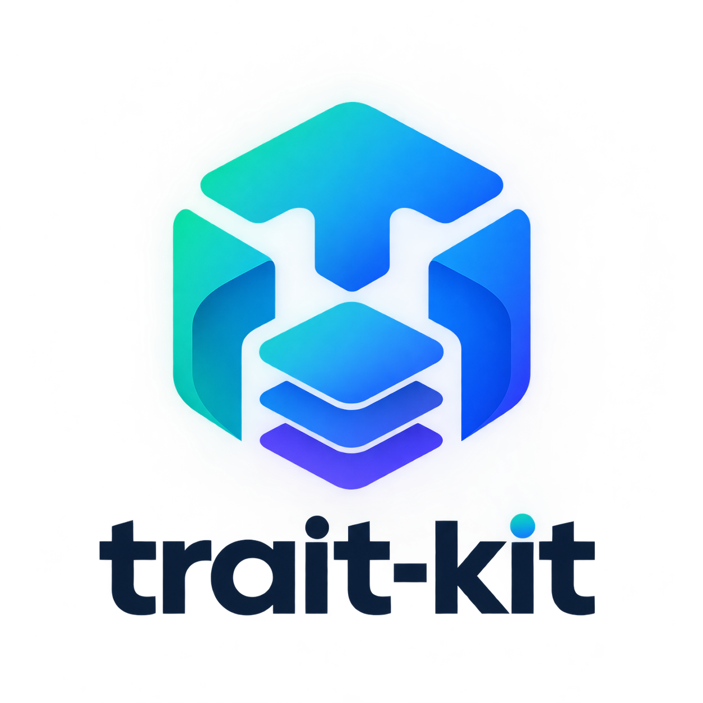

English | [中文](README_CN.md)

<div align="center">



[](https://www.rust-lang.org/) [](https://www.rust-lang.org/) [](https://crates.io/crates/trait-kit) [](https://docs.rs/trait-kit) [](https://crates.io/crates/trait-kit) [](https://github.com/Kirky-X/trait-kit/actions/workflows/ci.yml) [](https://codecov.io/gh/Kirky-X/trait-kit) [](./LICENSE)

**Standardized module interfaces + a `Kit` capability center**

[✨ Features](#-features) • [🚀 Quick Start](#-quick-start) • [📚 Documentation](#-documentation) • [💻 Examples](#-examples) • [🤝 Contributing](#-contributing)

</div>

---

## ✨ Features

<div align="center">

<table>
<tr>
<td width="50%">🧩 <b>Standardized Module Interface</b><br><sub>The <code>ModuleMeta</code> + <code>AutoBuilder</code> traits define a uniform contract; <code>impl_module_meta!</code> / <code>impl_auto_builder!</code> macros declare a module in one line.</sub></td>
<td width="50%">🏗️ <b>Typestate Build Validation</b><br><sub><code>Kit&lt;Unbuilt&gt;</code> registers modules and configs; <code>build()</code> validates the dependency graph (missing deps + cycle detection) and returns <code>Kit&lt;Ready&gt;</code>, surfacing errors before startup.</sub></td>
</tr>
<tr>
<td width="50%">🔎 <b>Type-Safe Capability Retrieval</b><br><sub>Capabilities are stored and retrieved by module type (<code>kit.require::&lt;M&gt;()</code>): no string keys, no downcast, no runtime lookup tables.</sub></td>
<td width="50%">🗂️ <b>Configuration Center</b><br><sub><code>set_config</code> / <code>config::&lt;C&gt;</code> store and retrieve typed configs via a <code>TypeId</code>-keyed <code>TypeMap</code>.</sub></td>
</tr>
<tr>
<td width="50%">⚙️ <b>confers Config Integration</b><br><sub>Three-level feature inheritance integrates <a href="https://crates.io/crates/confers">confers</a>: derive-macro config loading, hot-reload subscriptions, and XChaCha20-Poly1305 encrypted storage.</sub></td>
<td width="50%">🌐 <b>AsyncKit Async Support</b><br><sub>The <code>async</code> feature provides a <code>Send + Sync</code> <code>AsyncKit</code> for DB pools, HTTP clients, and other async initialization scenarios.</sub></td>
</tr>
<tr>
<td width="50%">🩺 <b>Runtime Observability</b><br><sub><code>lifecycle</code> hooks, <code>health</code> checks, <code>observer</code> build callbacks, and <code>shutdown</code> phased graceful shutdown.</sub></td>
<td width="50%">🌍 <b>ICU4X Internationalization</b><br><sub>Locale-aware number / date / plural / collation formatting, plus built-in Fluent FTL translation (<code>tr()</code>) for English and Chinese.</sub></td>
</tr>
<tr>
<td width="50%">🧱 <b>Minimal Default Dependencies</b><br><sub><code>default = []</code>: no optional feature enabled; only 3 mandatory deps ship by default (Fluent translation <code>fluent-bundle</code> / <code>unic-langid</code> and the <code>log</code> facade), while <code>confers</code>, <code>serde</code>, <code>serde_json</code>, <code>icu_*</code> (ICU4X components), etc. are all optional and feature-gated.</sub></td>
<td width="50%">🚫 <b>unsafe denied by default</b><br><sub><code>#![deny(unsafe_code)]</code> is enforced crate-wide; only 5 locally audited exemptions exist in production code (SAFETY-justified & code-reviewed): typestate layout-assert casts ×3, volatile zeroization ×1, guard lifetime re-anchoring ×1 (<code>AsyncTypeMap</code> <code>RwLock</code> read guard; the sync <code>TypeMap</code> now uses a <code>Ref::map</code> guard wrapper and needs no unsafe), plus 1 test-only exemption (<code>src/kit/config.rs</code>, zeroize spare-capacity assertion).</sub></td>
</tr>
</table>

</div>

For more capabilities (registration modes, build reports, composition, negotiation) and the "Why trait-kit?" comparison, see the [📖 User Guide](docs/en/USER_GUIDE.md).

---

## 🚀 Quick Start

### 📦 Installation

Minimum Supported Rust Version (MSRV): **1.97.1** (edition 2024).

```sh
cargo add trait-kit
```

Default features and dependency gating: see [📖 User Guide · Installation](docs/en/USER_GUIDE.md#installation).

### 💡 Minimal Example

Define a logger module, register it, build the Kit, then retrieve the capability (source: [examples/src/core/default_basic.rs](examples/src/core/default_basic.rs), trimmed):

```rust
use std::sync::Arc;
use trait_kit::prelude::*;

// 1. Define a capability (any Clone type)
struct StdoutLogger;
impl StdoutLogger {
    fn info(&self, msg: &str) {
        println!("[LOG] {msg}");
    }
}

// 2. Define the module: ModuleMeta declares the name and dependencies,
//    AutoBuilder declares how the capability is built
struct LoggerModule;
impl ModuleMeta for LoggerModule {
    const NAME: &'static str = "logger";
    fn dependencies() -> &'static [(&'static str, std::any::TypeId)] {
        &[]
    }
}

impl AutoBuilder for LoggerModule {
    type Capability = Arc<StdoutLogger>;
    type Error = TraitKitError;
    fn build(_kit: &Kit) -> Result<Self::Capability, Self::Error> {
        Ok(Arc::new(StdoutLogger))
    }
}

// 3. Register, build, and use
fn main() {
    let mut kit = Kit::new();
    kit.register::<LoggerModule>().unwrap();
    let kit = kit.build().unwrap();

    let logger = kit.require::<LoggerModule>().unwrap();
    logger.info("Hello from trait-kit!");
    assert!(kit.contains::<LoggerModule>());
}
```

---

## 📚 Documentation

| Document | Description |
|----------|-------------|
| [📖 User Guide](docs/en/USER_GUIDE.md) | Complete tutorial from installation to advanced usage |
| [📘 API Reference](docs/API_REFERENCE.md) | Quick reference for the core public APIs, each annotated with its feature gate (not exhaustive; the full list lives in rustdoc / docs.rs) |
| [🏗️ Architecture](docs/en/ARCHITECTURE.md) | Design patterns, data flow, thread-safety model, and directory layout |
| [🧪 Test Scenarios](docs/en/TEST_SCENARIOS.md) | Exhaustive acceptance-scenario matrix mapped to e2e tests |
| [⚡ Performance](docs/en/PERFORMANCE.md) | Criterion benchmark setup, baseline data, and reproduction method |
| [🔒 Security](docs/en/SECURITY.md) | Support policy, vulnerability reporting process, and security design |
| [📋 Changelog](docs/CHANGELOG.md) | Release notes for every version |
| [🤝 Contributing](docs/en/CONTRIBUTING.md) | Environment setup, TDD workflow, and commit conventions |
| [📦 crates.io](https://crates.io/crates/trait-kit) / [docs.rs](https://docs.rs/trait-kit) | Released versions and the online API docs |

---

## 💻 Examples

`examples/` is a standalone workspace member `trait-kit-examples` (`publish = false`) with 20 standalone runnable examples covering the core usage of 13 feature gates (`probe` / `report` / `compose` / `presets` / `presets-remote` / `version-negotiation` have no dedicated example yet; see the [📘 API Reference](docs/API_REFERENCE.md)). Run with:

```sh
cargo run -p trait-kit-examples --example <name> --features <feature>
```

See [examples/README.md](examples/README.md) for details.

---

## 🏗️ Architecture

The trait-kit workspace has three members: the main `trait-kit` crate, the proc-macro crate `trait-kit-macros` (`trait-kit-derive` was merged into it and retired in 0.5.0-rc.5), and the examples crate `trait-kit-examples`; the main crate's `src/` is organized into the `core` interface layer, the `kit` capability management center, and the `i18n` layer.

The workspace diagram, dependency-graph validation, data flow, thread-safety model, and directory layout are documented in full in the [Architecture document](docs/en/ARCHITECTURE.md).

---

## 🧪 Testing

The test strategy (unit / integration / compile-time UI / macro / doc tests / examples / benchmarks) and common commands (same as CI) live in the [🤝 Contributing Guide](docs/en/CONTRIBUTING.md#-test-strategy); the exhaustive acceptance-scenario matrix is in [🧪 Test Scenarios](docs/en/TEST_SCENARIOS.md).

---

## 📊 Performance

Performance comes from design: typestate moves dependency-graph validation entirely into `build()`, and capability retrieval on `Kit<Ready>` is a `TypeId` lookup + clone; the sync `Kit` is lock-free via `RefCell`.

Baseline numbers, the measurement environment, and reproduction commands live in [docs/en/PERFORMANCE.md](docs/en/PERFORMANCE.md).

---

## 🔒 Security

- **Vulnerability reporting**: do not open public issues; use GitHub's private [Security Advisories](https://github.com/Kirky-X/trait-kit/security/policy) channel ("Report a vulnerability"). The maintainer commits to acknowledging reports within 48 hours and providing an initial assessment within 7 days (see [docs/en/SECURITY.md](docs/en/SECURITY.md)).

For the complete security design, best practices, and fix history, see [docs/en/SECURITY.md](docs/en/SECURITY.md).

---

## 🤝 Contributing

Contributions are welcome! For full environment setup, the TDD workflow, and commit conventions, see the [Contributing Guide](docs/en/CONTRIBUTING.md).

---

## 📋 Changelog

See [CHANGELOG.md](docs/CHANGELOG.md).

---

## 📄 License

This project is licensed under the [MIT](https://github.com/Kirky-X/trait-kit/blob/main/LICENSE) License.

Copyright (c) 2026 Kirky.X🌠

---

## 🙏 Acknowledgments

- [`confers`](https://crates.io/crates/confers) — the underlying config loading, hot-reload, and encrypted storage capabilities.
- [ICU4X](https://github.com/unicode-org/icu4x) — internationalization formatting (number/date/plural/collation).
- [Project Fluent](https://projectfluent.org/) — the Fluent FTL message localization approach.
- [syn](https://github.com/dtolnay/syn) / [quote](https://github.com/dtolnay/quote) / [proc-macro2](https://github.com/dtolnay/proc-macro2) — the proc-macro foundation (for `trait-kit-macros`).
- [The Rust Community](https://www.rust-lang.org/community) — for the excellent language ecosystem and tooling.

---

## 📞 Contact & Support

- **Bugs & feature requests**: [GitHub Issues](https://github.com/Kirky-X/trait-kit/issues)
- **Security vulnerabilities**: do not report via public issues; see the vulnerability reporting process in the [Security document](docs/en/SECURITY.md).
- **Maintainer**: Kirky.X

---

## ⭐ Star History

[](https://star-history.com/#Kirky-X/trait-kit&Date)

### 💝 Support the Project

If you find this project useful, please consider giving it a ⭐️!
