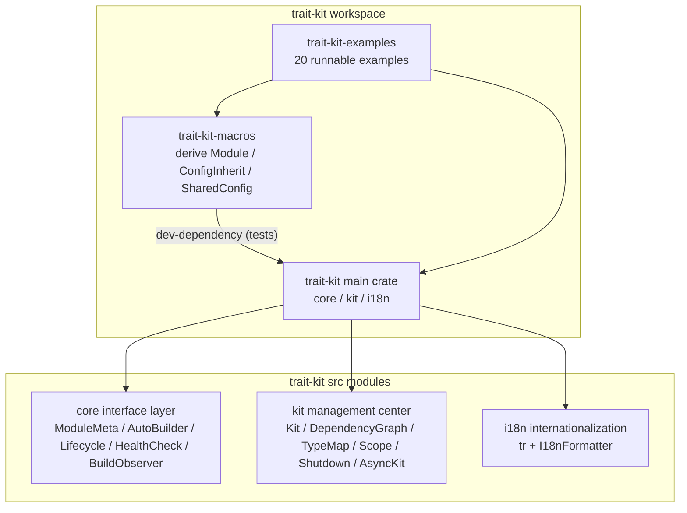
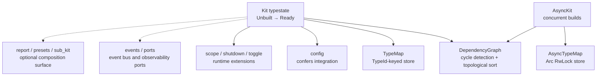
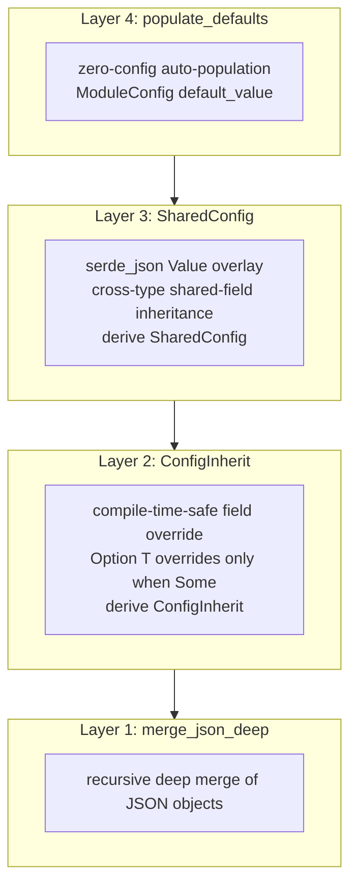
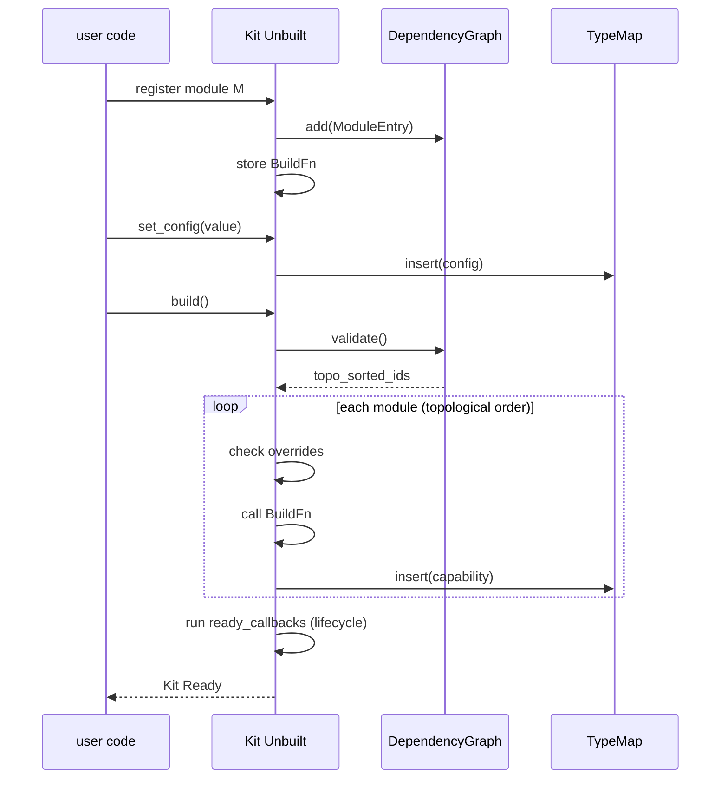
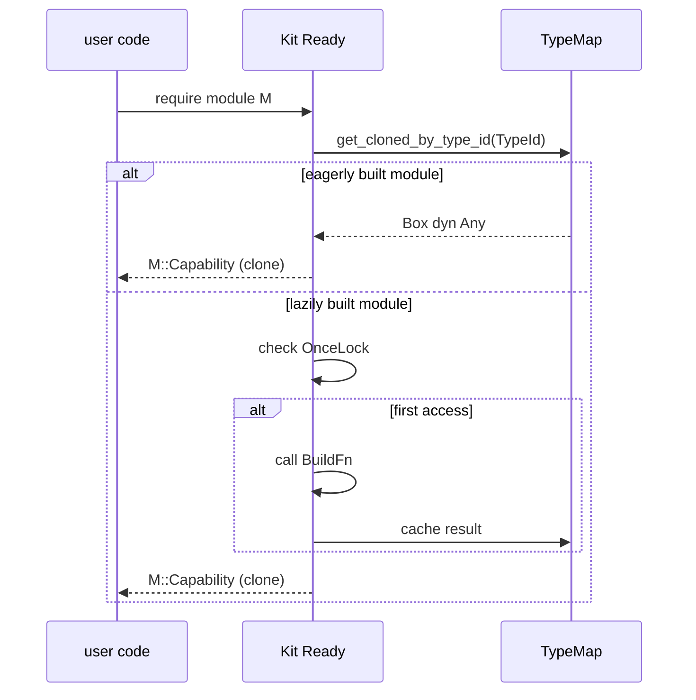

# 🏗️ Trait-Kit Architecture

trait-kit's architecture is designed around one core goal: **assembling module dependencies at application startup in a type-safe, verifiable way**.

## 📋 Table of Contents

<details open>
<summary>📑 Table of Contents</summary>

- [🗺️ Overall Architecture](#️-overall-architecture)
- [🧩 Core Design Patterns](#-core-design-patterns)
- [📦 Module System](#-module-system)
- [🔗 Self-Managed Library (confers) Gap Registry](#self-managed-library-confers-gap-registry)
- [🔄 Data Flow](#-data-flow)
- [📁 Directory Layout](#-directory-layout)
- [🧵 Thread-Safety Model](#-thread-safety-model)
- [🚪 Error Handling](#-error-handling)

</details>

---

## 🗺️ Overall Architecture

The trait-kit workspace consists of three members (the main crate, the proc-macro crate, and the examples crate). The main crate's `src/` is organized into three layers: the `core` interface layer, the `kit` capability management center, and `i18n` internationalization.



Relationships between components inside the `kit` management center:



## 🧩 Core Design Patterns

### Typestate Pattern

Kit uses the typestate pattern to ensure build-time validation:

```text
Kit<Unbuilt>                    Kit<Ready>
┌─────────────────┐   build()   ┌─────────────────┐
│ register()      │ ──────────→ │ require()       │
│ register_lazy() │             │ require_ref()   │
│ register_multi()│             │ optional()      │
│ register_as()   │             │ require_all()   │
│ set_config()    │             │ resolve()       │
│ build()         │             │ contains()      │
└─────────────────┘             │ health_check()  │
                                │ shutdown()      │
                                └─────────────────┘
```

- `Kit<Unbuilt>`: register modules, configs, and lifecycle hooks.
- `kit.build()`: validate the dependency graph → topological sort → build in order → return `Kit<Ready>`.
- `Kit<Ready>`: read-only capability retrieval; no further registration.

### Interior Mutability

- **Sync Kit**: based on `RefCell`, a single-threaded `!Sync` design that avoids lock overhead.
- **AsyncKit**: based on `Arc<RwLock>`, a multi-threaded `Send + Sync` design.

### Dependency-Graph Validation

`DependencyGraph` performs two-phase validation at `build()`:

1. **Missing-dependency detection**: ensures all declared dependencies are registered.
2. **Cycle detection + topological sort**: uses the Kahn algorithm; a cycle returns an error.

Builds execute in topological order, ensuring dependencies build before their consumers.

## 📦 Module System

### Capability Registration Modes

| Mode | Method | Description |
|---|---|---|
| Eager build | `register::<M>()` | Built in topological order during `build()` |
| Lazy build | `register_lazy::<M>()` | Built and cached on first `require()` |
| Multi-binding | `register_multi::<M>()` | Same type aggregated into a Vec, retrieved via `require_all()` |
| Interface separation | `register_as::<M>()` | `dyn Trait` type-erased registration |
| Conditional registration | `register_if::<M>(pred)` | Runtime predicate control |
| Override injection | `override_module::<M>(cap)` | Test injection, skipping build_fn |

### Feature Layering

Of the 19 canonical features (plus the 3 deprecated compatibility aliases `interface`/`scope`/`negotiate`), the confers family has an inheritance chain while the rest are zero-dependency standalone features:


### Four-Layer Config Inheritance

The `confers` feature provides a four-layer config inheritance mechanism supporting seamless config reuse across modules/projects:



**Data flow**: `TraitKitConfig` → `extract_shared` → `shared_fields overlay` → `inject_shared` → `DbConfig`

### Self-Managed Library (confers) Gap Registry

Some of trait-kit's facilities remain self-managed; migrating them to confers requires confers to close the following gaps first. For the full evidence chain (confers-side source locations, blocked migration surfaces, unlock benefits) see the specmark archive `selfdev-lib-adoption-r1` (2026-10-10 snapshot).

| # | Gap | confers-side status | Blocked migration surface | Priority | Current handling |
|---|---|---|---|---|---|
| 1 | `LocalDynamicField` (non-Send/Sync variant) | `DynamicField<T>` requires `T: Clone + Send + Sync + 'static`, callbacks are `Fn(&T) + Send + Sync` | Sync `Kit` subscriber bookkeeping (`Rc<dyn Fn()>`) | Medium | Keep self-managing `SubscriberMap` |
| 2 | `dynamic` has no lightweight non-tokio mode | `dynamic` pulls in `arc-swap`/`dashmap`/`tokio` | Dependency footprint of the `reload` feature | Medium | Footprint accepted (AsyncKit is a Send+Sync scenario anyway) |
| 3 | TypeId-heterogeneous registry | confers has no TypeId-keyed heterogeneous field registry | Per-config-type slot registration bookkeeping in AsyncKit/Kit | Low | Stays user-side, self-managed |
| 4 | `SecretBytes: From<Vec<u8>>` | Only `new(Vec<u8>)`; orphan rules prevent implementing it for trait-kit | `KeyBytes::from(vec)` construction sites | Low | Migrated to `KeyBytes::new(vec)` |

> This table is the **sole index** of the gap registry; exact line numbers and code citations drift with versions — the specmark archive snapshot prevails and they are not duplicated here.

## 🔄 Data Flow

### Build Flow



### Capability Retrieval Flow



## 📁 Directory Layout

```text
src/
├── lib.rs              # crate entry, re-exports
├── error.rs            # TraitKitError error type (i18n-localized)
├── redact.rs           # outbound-text redaction: strips credential fragments, absolute paths, and internal type paths (internal module)
├── prelude.rs          # re-exports of common types
├── core/
│   ├── mod.rs          # module declarations + re-exports
│   ├── meta.rs         # ModuleMeta / AutoBuilder / AsyncAutoBuilder / InterfaceBuilder
│   ├── macros.rs       # impl_module_meta! / impl_auto_builder! / impl_async_auto_builder!
│   ├── health.rs       # HealthCheck / AsyncHealthCheck / HealthStatus
│   ├── lifecycle.rs    # Lifecycle / AsyncLifecycle
│   ├── observer.rs     # BuildObserver
│   └── probe.rs        # ServiceProbe / ProbeReport / ProbeEntry (probe feature)
├── kit/
│   ├── mod.rs          # Kit module declarations + re-exports
│   ├── kit.rs          # Kit<Unbuilt> → Kit<Ready> typestate implementation
│   ├── kit_tests.rs    # standalone file carrying kit.rs's inline tests
│   ├── graph.rs        # DependencyGraph: cycle detection + topological sort
│   ├── typemap.rs      # TypeMap: TypeId-keyed store
│   ├── scope.rs        # Scope / AsyncScope
│   ├── shutdown.rs     # ShutdownCoordinator / AsyncShutdownCoordinator
│   ├── soft_build.rs   # soft_build degraded-build helper (falls back to the fallback capability on failure)
│   ├── toggle.rs       # ToggleBackend / MemoryToggle / typed toggle handles
│   ├── async_kit.rs    # AsyncKit (concurrent builds + Send + Sync)
│   ├── async_typemap.rs # AsyncTypeMap
│   ├── config.rs       # confers integration (incl. encrypted storage / KeyProvider)
│   ├── events.rs       # EventBus / KitEvent / MemoryEventBus
│   ├── ports.rs        # MetricsPort / LogPort observability ports
│   ├── report.rs       # BuildReport structured build report
│   ├── presets.rs      # ConfersConfigModule preset module package
│   └── sub_kit.rs      # sub-Kit composition (compose feature)
└── i18n/
    ├── mod.rs          # I18nManager + I18nFormatter + tr()
    ├── i18n_impl.rs    # implementation details
    └── messages/
        └── mod.rs      # FTL embedding (include_str! inlines the domain files under locales/ at the repo root)

locales/               # FTL language packs (repo root, split by domain, outside src/)
├── en/
│   ├── errors.ftl     # English error messages
│   ├── logs.ftl       # English log / degradation / probe-payload messages
│   └── examples.ftl   # English example demo output
└── zh/
    ├── errors.ftl     # Chinese error messages
    ├── logs.ftl       # Chinese log / degradation / probe-payload messages
    └── examples.ftl   # Chinese example demo output
```

## 🧵 Thread-Safety Model

| Type | Send | Sync | Notes |
|---|---|---|---|
| `Kit<S>` | ✗ | ✗ | `RefCell` interior mutability |
| `AsyncKit<S>` | ✓ | ✓ | `Arc<RwLock>` |
| `Scope` | ✗ | ✗ | `RefCell` |
| `AsyncScope` | ✓ | ✓ | `Arc<RwLock>` |
| `TypeMap` | ✗ | ✗ | `RefCell<HashMap>` |
| `AsyncTypeMap` | ✓ | ✓ | `Arc<RwLock<HashMap>>` |
| `BuildObserver` | ✓ | ✓ | trait bound: `Send + Sync` |
| `ShutdownCoordinator` | ✗ | ✗ | `RefCell` |
| `AsyncShutdownCoordinator` | ✓ | ✓ | `Arc<RwLock>` |

## 🚪 Error Handling

`TraitKitError` unifies all Kit operation errors; `Display` is automatically localized via `tr()`. For trigger scenarios and handling advice for every variant see the [User Guide · Troubleshooting](USER_GUIDE.md#-troubleshooting); for the enum definition and fields see [API Reference · Error Types](API_REFERENCE.md#-error-types).
